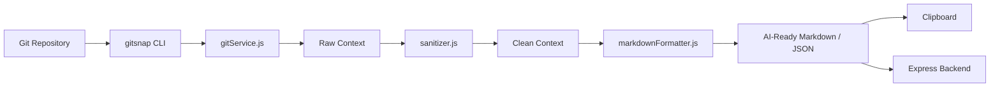

<div align="center">

# 📦 gitsnap-cli

**Safe. Fast. AI-Ready Git Context Snapshots.**

[](https://github.com/lakshyakurup/gitsnap-cli)
[](LICENSE)
[](https://nodejs.org)
[](CONTRIBUTING.md)
[](https://standardjs.com)
[](https://github.com/lakshyakurup/gitsnap-cli)
[](https://github.com/lakshyakurup/gitsnap-cli)
[](https://github.com/lakshyakurup/gitsnap-cli/graphs/commit-activity)

A production-ready CLI that captures sanitized Git context (branch, status, diff, commits, recent files) and formats it into clean Markdown or JSON — perfect for pasting into ChatGPT, Claude, Cursor, Copilot, Grok and any AI coding assistant.

**Never leak secrets. Always produce clean, scannable context.**

[Quick Start](#-quick-start) • [Demo](#-demo) • [Features](#-features) • [Usage](#-full-cli-reference) • [Architecture](#-architecture) • [Security](#-security) • [Contributing](#-contributing)

</div>

---

## 🚀 Quick Start

```bash
# Install & link
npm install
npm link

# Basic snapshot
gitsnap

# Full power
gitsnap --diff --commits 10 --files 8 --copy
```

That’s it. The output is ready to paste into any AI chat.

---

## 🎬 Demo

### 1. Basic Snapshot

```bash
gitsnap
```

**Sample output:**
```markdown
## Git Context Snapshot
**Branch:** main

### Status
```
 M README.md
 M cli.js
```

### Commits
```
a1b2c3d - lakshya: improve sanitizer
e4f5g6h - lakshya: add --files flag
```
```

### 2. Full Context + Clipboard

```bash
gitsnap --diff --commits 5 --files 6 --copy
```

**What happens:**
- Captures current branch + status
- Includes the last 5 commits
- Lists the 6 most recently changed files
- Adds the full diff
- Copies everything to your clipboard automatically

### 3. JSON Mode (for scripts / CI)

```bash
gitsnap --diff --json
```

### 4. Real-world Workflow

```bash
# Make some changes in your project
vim src/app.js

# Capture everything and paste into Claude / ChatGPT / Cursor
gitsnap -d -n 8 -f 10 -c

# Now just Ctrl+V into your AI chat
```

> ✨ Tip: Add an alias to your shell:
> ```bash
> alias gs='gitsnap --diff --copy'
> ```

---

## ✨ Features

| Feature | Description |
|---------|-------------|
| **Secret Sanitization** | Automatically redacts API keys, JWTs, private keys, connection strings, `.env` values |
| **AI-Optimized Markdown** | Clean headings and code blocks designed for LLM consumption |
| **JSON Mode** | Machine-readable output for tooling and pipelines |
| **Clipboard Support** | One flag copies the entire snapshot to your clipboard |
| **Configurable Commits** | Control how many recent commits appear |
| **Recent Files** | List the most recently changed files |
| **Zero Heavy Dependencies** | Only Express for the optional backend |
| **Cross-platform** | Works on macOS, Linux and Windows |

---

## 📋 Full CLI Reference

| Flag | Short | Description | Default |
|------|-------|-------------|---------|
| `--diff` | `-d` | Include full `git diff` output | off |
| `--copy` | `-c` | Copy the final output to clipboard | off |
| `--commits <N>` | `-n` | Number of recent commits to include (1–50) | `3` |
| `--files <N>` | `-f` | Number of most recently changed files to list (0–50) | `0` (off) |
| `--json` | `-j` | Output structured JSON instead of Markdown | off |
| `--no-secret-mask` | | Disable secret masking (debug only) | off |

### Usage Examples

```bash
gitsnap
gitsnap --diff --copy
gitsnap -d -n 15 -f 12 --copy
gitsnap --diff --json > context.json
```

---

## 🏗️ Architecture



---

## 🛡️ Security

The sanitizer redacts API keys, JWTs, private keys, connection strings, and `.env` values automatically.

---

## 💻 Installation

```bash
git clone https://github.com/lakshyakurup/gitsnap-cli.git
cd gitsnap-cli
npm install && npm link
npm test
```

---

## 👥 Contributing

1. Fork the repo
2. Create a branch (`git checkout -b feature/amazing`)
3. Make your changes + run `npm test`
4. Commit and open a Pull Request

See [CONTRIBUTING.md](CONTRIBUTING.md) for more details.

---

## 📚 License

MIT © [lakshyakurup](https://github.com/lakshyakurup)
