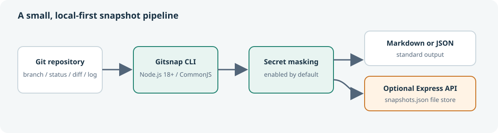
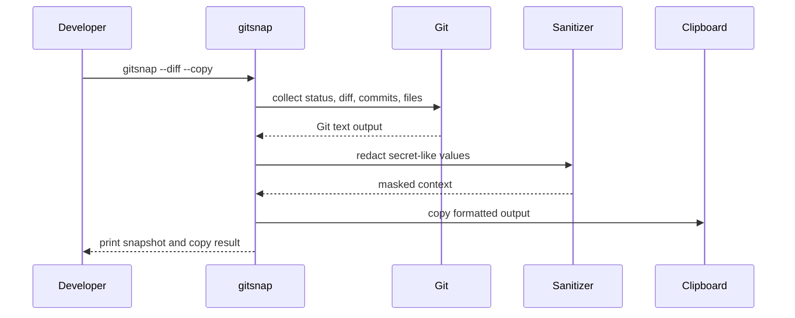
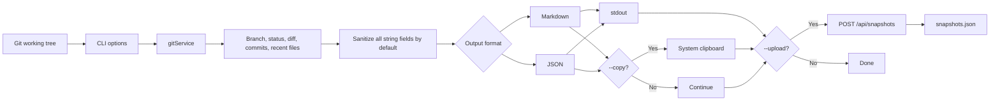

<div align="center">

# Gitsnap CLI

**Safe, fast, AI-ready Git context snapshots.**

[](https://github.com/lakshyakurup/gitsnap-cli)
[](LICENSE)
[](https://nodejs.org)
[](package.json)
[](CONTRIBUTING.md)

Gitsnap captures Git branch, status, diff, recent commits, and recently changed files, then formats that context as Markdown or JSON. Copy it to your clipboard, pipe it into another tool, or upload it to the optional local API.

</div>



## Contents

- [Quick start](#quick-start)
- [Demo](#demo)
- [Features](#features)
- [Requirements and language support](#requirements-and-language-support)
- [CLI reference](#cli-reference)
- [Usage workflows](#usage-workflows)
- [Output format](#output-format)
- [Architecture and data flow](#architecture-and-data-flow)
- [Optional backend API](#optional-backend-api)
- [Security and privacy](#security-and-privacy)
- [Development and tests](#development-and-tests)
- [Project structure](#project-structure)
- [Limitations](#limitations)
- [Troubleshooting](#troubleshooting)
- [Contributing and license](#contributing-and-license)

## Quick start

Requirements: Node.js 18 or newer, npm, and Git installed and available on `PATH`.

```bash
git clone https://github.com/lakshyakurup/gitsnap-cli.git
cd gitsnap-cli
npm install
npm link
```

Run Gitsnap from the root of any Git repository:

```bash
# Markdown snapshot with default masking
gitsnap

# Include the unstaged diff and copy the result
gitsnap --diff --copy

# More commits and recently changed files
gitsnap --commits 10 --files 8
```

You can also run the checked-out CLI without `npm link`:

```bash
node /path/to/gitsnap-cli/index.js --json
```

## Demo

The default output is Markdown. A snapshot contains a branch line and whichever context sections have content:

````markdown
## Git Context Snapshot
**Branch:** feature/auth-refactor

### Status
```
 M src/auth.js
?? src/utils/token.js
```

### Recent Files
```
src/auth.js
src/utils/token.js
```

### Diff
```diff
diff --git a/src/auth.js b/src/auth.js
...
```

### Commits
```
a1b2c3d - Example Author: Fix token expiry
e4f5a6b - Example Author: Add refresh logic
```
````

Recognized secrets are replaced with `[REDACTED]` by default. The `docs/architecture.svg` image above illustrates the command path and optional API.

## Features

| Feature | Behavior |
| --- | --- |
| Markdown output | Readable branch, status, recent files, optional diff, and commit sections |
| JSON output | Structured snapshot for scripts and automation |
| Secret masking | Enabled by default for Markdown, JSON, clipboard content, and uploads |
| Diff capture | Includes unstaged changes to tracked files when requested |
| Recent commits | Select between 1 and 50 commit messages; defaults to 3 |
| Recent files | List between 0 and 50 paths from recent committed history; defaults to off |
| Clipboard | Copies the formatted result using the platform clipboard utility |
| Optional upload | POST the snapshot to the local Express API |
| Language agnostic | Captures Git text; it does not parse source code by programming language |

## Requirements and language support

| Technology | Use |
| --- | --- |
| JavaScript, CommonJS | Published CLI, Git integration, sanitizer, formatter, and API server |
| Node.js 18+ | Runtime; built-in `fetch` powers API uploads |
| Git | Supplies branch, status, diff, commit history, and changed-file history |
| npm | Installs dependencies, links the executable, and runs scripts |
| Express | Optional local HTTP API; the root package's only runtime dependency |
| JSON | Machine output, request bodies, package metadata, and local API storage |
| Markdown | Default output and project documentation |
| Bash | Optional `dev.sh` convenience script |

Gitsnap works with repositories containing JavaScript, TypeScript, Python, Java, Go, Rust, or other languages because it reads Git's text output. It does not analyze or understand those programming languages, and there are no language-specific SDKs. Other programs can invoke `gitsnap --json` through their process APIs; examples appear below.

## CLI reference

Run flags inside the repository to snapshot. The current CLI uses options rather than subcommands such as `snapshot`, `status`, or `export`.

| Flag | Short | Default | Description |
| --- | --- | --- | --- |
| `--diff` | `-d` | Off | Include `git diff` output for unstaged changes to tracked files. |
| `--copy` | `-c` | Off | Copy the final formatted output to the system clipboard. |
| `--commits <N>` | `-n` | `3` | Include 1 to 50 recent commit messages. |
| `--files <N>` | `-f` | `0` (off) | Include 0 to 50 distinct paths from recent committed file history. |
| `--json` | `-j` | Off | Print formatted JSON instead of Markdown. |
| `--upload` | `-u` | Off | POST the snapshot to `<API URL>/snapshots`. |
| `--secret-mask` | `-m` | On | Explicitly enable secret masking; masking is enabled by default. |
| `--no-secret-mask` |  | Off | Disable masking. Dangerous: raw repository content may be printed, copied, or uploaded. |
| `--api-url <url>` |  | `http://localhost:4000/api` | Set the API base URL for uploads. Accepts HTTP or HTTPS. |

`--api-url=<url>` is also accepted. API URLs may not contain query strings or fragments. Unknown flags are currently ignored.

### Usage examples

```bash
# Minimal snapshot
gitsnap

# Most common: diff and clipboard
gitsnap --diff --copy

# Full context for a larger change
gitsnap -d -n 15 -f 12 --copy

# JSON for scripts or CI
gitsnap --diff --json > context.json

# Upload to the default local API
gitsnap --upload

# Upload the diff to a different local port
gitsnap --diff --upload --api-url http://localhost:4100/api
```

On upload success, the snapshot is still printed to standard output and a confirmation goes to standard error. Errors are written to standard error and set a non-zero exit status. Clipboard support uses `pbcopy` on macOS, `clip` on Windows, and `xclip` or `xsel` on Linux.

### Use JSON from Node.js

```js
const { execFileSync } = require('node:child_process');

const output = execFileSync('gitsnap', ['--json'], { encoding: 'utf8' });
const snapshot = JSON.parse(output);
console.log(snapshot.branch);
```

### Use JSON from Python

```python
import json
import subprocess

result = subprocess.run(
    ["gitsnap", "--json"],
    check=True,
    capture_output=True,
    text=True,
)
snapshot = json.loads(result.stdout)
print(snapshot["branch"])
```

The same process pattern works in other languages. No language-specific binding is provided.

## Usage workflows

### Create context for an AI tool

1. Change into the Git repository you want to share.
2. Run `gitsnap --diff --commits 10 --files 8` or select the flags that fit your task.
3. Review the output for sensitive or proprietary information.
4. Paste it into your preferred code assistant or review workflow.

### Copy a snapshot



### Upload a snapshot

1. Start the optional API with `npm start` in the Gitsnap checkout.
2. Run `gitsnap --upload` from the repository to snapshot. Add `--diff` to include unstaged tracked changes.
3. The CLI sanitizes the snapshot by default and POSTs JSON to `<api-url>/snapshots`.
4. The API appends the request body to `snapshots.json` and returns the saved record.
5. The CLI prints the formatted snapshot; upload confirmation is written to standard error.

Uploading does not remove the need to review content before sharing. Direct calls to the API bypass the CLI sanitizer.

## Output format

JSON output is a pretty-printed object. String fields are sanitized before printing unless `--no-secret-mask` is used.

| Field | Description |
| --- | --- |
| `branch` | Current branch name, or `HEAD` if Git returns no branch name. |
| `status` | Output of `git status --porcelain`. |
| `diff` | Output of `git diff` when `--diff` is selected; otherwise empty. |
| `commitLog` | Up to the requested number of commits, formatted as short hash, author, and subject. |
| `recentFiles` | Up to the requested number of distinct paths from recent committed history; empty by default. |

Example shape:

```json
{
  "branch": "main",
  "status": " M src/cli.js",
  "diff": "",
  "commitLog": "a1b2c3d - Example Author: Improve CLI output",
  "recentFiles": "src/cli.js\nREADME.md"
}
```

Markdown output starts with `Git Context Snapshot` and a branch line, then includes non-empty status, recent files, diff, and commits sections. The diff is fenced as `diff` for readability.

## Architecture and data flow




| Component | Responsibility |
| --- | --- |
| `index.js` | Executable entry point, standard output/error handling, exit status |
| `cli.js` | Option parsing, context preparation, output selection, clipboard, uploads |
| `gitService.js` | Runs Git commands and assembles repository context |
| `sanitizer.js` | Redacts secret-like values before the snapshot is shared |
| `markdownFormatter.js` | Builds the Markdown representation |
| `server.js` | Optional Express routes and file-backed persistence |

The package's `gitsnap` executable uses the root files above. The separate `src/` tree and `packages/plugin-*` workspace stubs are not loaded by that executable.

## Optional backend API

The API is optional. Start it from the Gitsnap checkout:

```bash
npm start
```

The default port is `4000`. To use another port, set `PORT` and point `--api-url` at the matching base URL:

```bash
PORT=4100 npm start
# In another terminal, from a Git repository:
gitsnap --upload --api-url http://localhost:4100/api
```

| Method | Path | Purpose | Success |
| --- | --- | --- | --- |
| `GET` | `/health` | Health check | `200` with service status JSON |
| `GET` | `/api/snapshots` | Return saved snapshots | `200` with a JSON array |
| `POST` | `/api/snapshots` | Store the request body | `201` with the stored snapshot |

Example health check:

```bash
curl http://localhost:4000/health
```

Example direct request (does not pass through CLI sanitization):

```bash
curl --fail-with-body \
  -H 'Content-Type: application/json' \
  -d '{"branch":"main","status":"","diff":"","commitLog":"","recentFiles":""}' \
  http://localhost:4000/api/snapshots
```

The API adds an `id` and `generatedAt` property, then writes records to `snapshots.json` beside `server.js`. This is a synchronous local JSON-file store, not a database.

## Security and privacy

Masking is on by default and is applied before output formatting, clipboard copying, and API uploads. It is a best-effort defense, not a guarantee that arbitrary repository content is safe to disclose.

| Pattern family | Examples |
| --- | --- |
| Sensitive assignments | Names containing `SECRET`, `KEY`, `TOKEN`, `PASSWORD`, `AUTH`, `CREDENTIAL`, or private/API-key terms |
| Provider credentials | OpenAI/Anthropic `sk-...`, GitHub tokens, AWS access keys, Google API keys, Slack tokens |
| Authentication tokens | Bearer tokens and JWT-shaped strings |
| Private keys | PEM-style RSA, OpenSSH, EC, and DSA private-key blocks |
| Database connection strings | PostgreSQL, MySQL, MongoDB, and Redis URLs |
| Opaque high-entropy strings | Long candidate strings with at least 32 characters and estimated entropy of 4.2 bits per character or greater |

Important safety notes:

- `--no-secret-mask` disables redaction for printed, copied, and uploaded data. Do not use it with unreviewed content or shared logs.
- Heuristic masking can redact opaque values that are not credentials and can miss secrets in unfamiliar formats.
- Diffs can contain proprietary code, personal data, and credentials even when no recognized token pattern is present. Review snapshots before sharing.
- Direct API requests are not sanitized by the server.
- The backend has no authentication, authorization, schema validation, encryption, or retention policy. Keep it on a trusted local network and do not expose it directly to the public internet.

## Development and tests

The published package uses CommonJS and supports Node.js 18 or newer. Runtime dependencies are intentionally small; Express is the root package's only dependency.

| Command | Purpose |
| --- | --- |
| `npm install` | Install dependencies and local workspaces. |
| `npm test` | Run sanitizer regressions and CLI tests. |
| `npm start` | Start the optional Express API. |
| `npm link` | Link the `gitsnap` executable for local testing. |
| `npm run snap` | Run the configured diff snapshot shortcut. |
| `npm run snap:copy` | Run the diff snapshot shortcut and copy the output. |

The `dev.sh` helper runs tests and links the package. Run it from the repository root with Bash.

## Project structure

| Path | Purpose |
| --- | --- |
| `index.js` | Published CLI entry point |
| `cli.js` | Flag parser and snapshot workflow |
| `gitService.js` | Git command integration |
| `sanitizer.js` | Secret masking implementation |
| `markdownFormatter.js` | Markdown rendering |
| `server.js` | Optional API server |
| `cli.test.js`, `sanitizer.test.js` | Tests used by `npm test` |
| `src/` | Separate modular source tree, not the package bin entry point |
| `packages/plugin-*` | Workspace plugin stubs, not loaded by the CLI |
| `docs/` | API, examples, usage, and architecture illustration |
| `AGENT.md` | Repository guidance for coding agents |
| `CONTRIBUTING.md` | Contributor workflow and expectations |

## Limitations

- `--diff` uses `git diff`, so it includes unstaged changes to tracked files; it does not include staged diffs or untracked file contents.
- `--files` reports paths from committed history, not every current working-tree file.
- Commit and file counts are capped at 50.
- Git command failures are currently converted to empty strings; running outside a Git working tree may produce incomplete output instead of a clear validation error.
- Git output is buffered in memory. There is no streaming or smart truncation for very large diffs.
- The API is a local development-oriented file store. It has no search, tags, comparison, pagination, or delete route.
- Unknown flags are ignored, and there is no `--help` output yet.

## Troubleshooting

| Symptom | Likely cause and next step |
| --- | --- |
| `gitsnap: command not found` | Run `npm link` in this checkout, or invoke `node /path/to/gitsnap-cli/index.js`. |
| Clipboard copy fails | On Linux install `xclip` or `xsel`; on macOS `pbcopy` is used; on Windows `clip` is used. |
| Snapshot has no branch or status | Confirm Git is installed and run inside a Git working tree. Git failures are quiet in the current Git service. |
| Upload reports connection refused | Start the backend with `npm start`, check `PORT`, and use the matching `--api-url`. |
| API URL is rejected | Use an absolute HTTP or HTTPS URL without a query string or fragment. |
| A value is redacted unexpectedly | Entropy detection is heuristic; inspect the local value without disabling masking on content you plan to share. |

## Contributing and license

Contributions are welcome. Keep changes focused, preserve secret masking, add regression tests for new sanitizer behavior, and update documentation when CLI behavior changes. Run `npm test` before submitting changes. See [CONTRIBUTING.md](CONTRIBUTING.md) and [AGENT.md](AGENT.md) for repository-specific guidance.

This project is distributed under the [MIT License](LICENSE).
